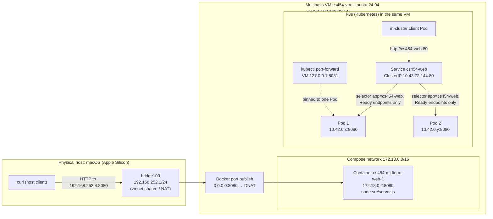

# One Service, Two Deployment Environments — Technical Report

CS454 Midterm Mini-Project · Evidence referenced as **E1–E6** is in [evidence/EVIDENCE.md](../evidence/EVIDENCE.md).

## 1. Environment and layering

Everything runs on one physical machine, a **MacBook (Apple Silicon, macOS)**. Multipass uses the macOS Hypervisor framework (QEMU) to run a **virtual machine**, `cs454-vm` (Ubuntu 24.04, 2 vCPU, 3 GB). The VM has its own Linux kernel. Inside the VM two independent container runtimes run side by side:

- **Docker Engine**, which runs the Compose **container**; and
- **k3s**, a single-node Kubernetes whose embedded **containerd** runs the Pod containers.

A container is not a VM. It is an ordinary Linux process tree isolated by namespaces and cgroups and sharing the VM's kernel. The innermost layer is the **application process**, `node src/server.js` (PID 1 inside each container, E6). The request counter lives in that process's memory, which is why it resets whenever the process is replaced.

Both environments run the same image, `cs454-midterm:1.0.0`. It is built once by `docker compose build` and copied into k3s with `docker save | k3s ctr images import -`. The Deployment uses `imagePullPolicy: Never`, so Kubernetes never contacts a registry. The import output shows the same index digest (`1af027cc…`) as Docker's image ID (E3).

### Deployment diagram



<details><summary>Plain-text version of the diagram</summary>

```
 macOS host ─────────────────────────────────────────────────────────────────────────────
  curl http://192.168.252.4:8080/
     │   bridge100 192.168.252.1  (Multipass/vmnet shared network, NAT; no port forwarding)
     ▼
 ┌─ VM cs454-vm (Ubuntu 24.04)  enp0s1 192.168.252.4 ────────────────────────────────────┐
 │  :8080 (docker-proxy / iptables DNAT)                                                 │
 │     ▼                                                                                 │
 │  [container cs454-midterm-web-1  172.18.0.2:8080]  → node src/server.js               │
 │                                                                                       │
 │  k3s:  client Pod ──► Service cs454-web 10.43.72.144:80 ──► Pod A 10.42.0.x:8080      │
 │                         (selector app=cs454-web)        └──► Pod B 10.42.0.y:8080      │
 │        kubectl port-forward 127.0.0.1:8081 ─────────────────► (one Pod only)           │
 └───────────────────────────────────────────────────────────────────────────────────────┘
```
</details>

**Request path from the host (Compose):** the Mac's `curl` connects to `192.168.252.4:8080`. Multipass on macOS uses vmnet *shared* mode, a NAT network where the host owns `192.168.252.1` on `bridge100` and can route directly to the VM's private address, so no port-forward rule is needed. In the VM, Docker's published port (`"8080:8080"`) installs a DNAT rule, `--dport 8080 -j DNAT --to-destination 172.18.0.2:8080` (E2), which delivers the packet to the container's network namespace, where Node listens on `0.0.0.0:8080`.

## 2. Docker Compose in the VM

Compose ran one container and reported it `Up … (healthy)` through a `wget`-based healthcheck. Requests worked from inside the VM (`localhost:8080`) and from the Mac (`192.168.252.4:8080`), and every request appeared as a JSON log line in `docker compose logs` (E2).

**Restart observation:** before the restart the counter was 6. `docker compose restart web` sent SIGTERM (the log shows `Received SIGTERM; stopping.` then `Listening on port 8080`), and the next request returned `requestCount: 1` with the **same hostname** `295a0125c83c`. The container was reused but the process was new, so its in-memory state was lost. `docker compose down/up` went further: a new container with a new hostname. Killing the process with `kill -9` triggered `restart: unless-stopped`, and Docker restarted **the same container on the same VM** (`restarts=1`).

## 3. Kubernetes deployment

The Deployment requests `replicas: 2` and labels its Pods `app=cs454-web`. The ClusterIP Service selects that label and maps port 80 to the container's named port `http` (8080). E3 shows `READY 2/2`, two `1/1 Running` Pods, and an EndpointSlice listing both Pod IPs.

**Access methods and what they prove.** `kubectl port-forward service/cs454-web` returned 200 for `/` and `/health`, but all four requests reported the same hostname. kubectl resolves the Service to **one** Pod once and tunnels to it through the kubelet; it does not use the ClusterIP or kube-proxy. It proves the Service's selector resolved to a working Pod at connect time, and nothing about load balancing. To exercise the real Service data path I also ran a throwaway client **Pod** (`scripts/svc-requests.sh`) that calls `http://cs454-web/`. Its requests went through cluster DNS → ClusterIP → kube-proxy rules and reached **both** Pods.

**Pod replacement.** Deleting a Pod while the Deployment still specified two replicas caused the ReplicaSet to create a replacement at once (`Created pod: …-fx78m`, and on a second run `qq2b2` appeared at age 0s while `qrvmg` was still Terminating). The new Pod went `ContainerCreating → Running 0/1 → 1/1` once its readiness probe passed (≈6 s), and the EndpointSlice swapped the old IP for the new one (E4). This happens because Kubernetes is **declarative**: the ReplicaSet controller keeps comparing observed state (1 matching Pod) to desired state (`replicas: 2`) and acts to close the gap. Deleting a Pod is not "stopping the app", just a change in observed state that the controller corrects. The replacement is a **new object** with a new name, IP and process, so its counter started at 1 while the surviving Pod kept counting.

**Compared with Compose:** Compose's restart policy restarts a container *in place* when its process exits. It does not hold a replica count, does not recreate a container I remove, and has no idea of a second machine. `docker compose restart` is an imperative action I issued. In Kubernetes, *I* changed nothing and the control loop restored the desired state on its own. In both cases process-local state (the counter) was lost, which is why it is never synchronized.

## 4. Controlled troubleshooting: Service selector mismatch

| | |
|---|---|
| **Baseline** | Selector `{"app":"cs454-web"}`; Pods labeled `app=cs454-web`; EndpointSlice `10.42.0.9,10.42.0.11`; in-cluster requests and a port-forward return 200. |
| **Change** | `kubectl patch service cs454-web --type merge -p '{"spec":{"selector":{"app":"cs454-web-broken"}}}'`. The Deployment was not touched. |
| **Client symptom** | In-cluster client: `ECONNREFUSED` on every request. A **new** `kubectl port-forward service/cs454-web` waited and then failed with `error: timed out waiting for the condition` after 60 s. |
| **Observation 1** | Deployment `2/2`, both Pods `1/1 Running`, logs show only successful `/health` probes, so the application is healthy. |
| **Observation 2** | `kubectl get svc -o wide` → `SELECTOR app=cs454-web-broken`; `kubectl get pods -l app=cs454-web-broken` → *No resources found*. The selector matches nothing. |
| **Observation 3** | EndpointSlice `PORTS <unset>  ENDPOINTS <unset>`; `describe svc` → `Endpoints:` empty. |
| **Observation 4** | kube-proxy rule `"default/cs454-web:http has no endpoints" … -j REJECT --reject-with icmp-port-unreachable`, which is exactly why clients got *connection refused* rather than a timeout. |
| **Cause** | A Service has no fixed list of backends. The EndpointSlice controller fills its EndpointSlice with the Ready Pods whose labels match the selector. With no match there are zero endpoints, so there is nowhere to send traffic. |
| **Correction** | `kubectl apply -f k8s/service.yaml` re-applied the declared selector; endpoints reappeared, the REJECT rule disappeared, and both the in-cluster client and a **newly started** port-forward returned 200 from both Pods. |

One mistake during the run turned out to be informative. A port-forward started **before** the change, which my script had failed to stop, kept answering after the selector was broken, and an even older session died with `lost connection to pod` once its Pod was deleted (notes in E5/05a). A port-forward fixes on one Pod when it starts and never re-reads the Service, which is why the test had to be repeated with a fresh session.

**Why healthy Pods are not proof of reachability:** Pod readiness and a direct request to a Pod IP only test the bottom of the stack. Reaching the app *through the Service* also depends on the selector matching the Pod labels, the EndpointSlice being populated, `targetPort` matching the container port, kube-proxy rules, and DNS. In this experiment every Pod-level signal was green and the Service still had zero backends. Labels and selectors are loosely coupled by design, so Kubernetes accepted the broken selector without complaint.

## 5. CS554 extension: resources and readiness

**Settings.** Requests `cpu: 50m, memory: 64Mi`; limits `cpu: 250m, memory: 128Mi` (QoS *Burstable*). A **request** is a reservation used by the scheduler for placement and guaranteed under contention. A **limit** is an upper bound enforced at runtime: CPU above 250m is throttled by the cgroup, and memory above 128 Mi gets the container OOM-killed and restarted. `kubectl top` showed ≈3m CPU and 10 Mi per Pod at idle, so the requests are modest but leave room for request bursts and V8 heap growth. The limits cap a runaway replica without starving the 2-vCPU VM, which also runs Docker and the k3s control plane (node total: 15% CPU / 9% memory requested).

**Readiness.** The probe calls `GET /health` every 5 s and marks the Pod NotReady after 2 failures. Readiness does not restart anything. It sets the Pod's `Ready` condition, and the EndpointSlice controller sets that endpoint's `conditions.ready`, which kube-proxy uses to include or exclude it. A *liveness* failure (or a crash) would restart the container. I deliberately defined no liveness probe on `/health`, because it would have turned this experiment into a restart.

**Experiment.** Kubernetes rejected a per-Pod probe patch (`pod updates may not change fields other than …`), so I used the documented `NOT_READY_FILE` toggle. `touch /tmp/not-ready` in **one** Pod made `/health` return 503. Within ~10 s that Pod was `0/1 Running` with **0 restarts**, the Deployment showed `1/2`, its endpoint was `ready=false`, and eight Service requests from an in-cluster client all landed on the other Pod. Meanwhile `ps` still showed `node src/server.js` as PID 1, and a direct request to the Pod IP still returned 200. Removing the file restored `ready=true`, and the Pod's counter continued from 15 to 16, which proves the same process served throughout (E6).

## 6. OpenStack deployment plan

**Resources and choices.** I would boot one instance from the cloud's **Ubuntu 24.04 cloud image** in Glance. It is normally supplied by the administrator and includes cloud-init. A **small flavor** (e.g. `m1.small`: 1 vCPU, 2 GB RAM, 20 GB disk) is enough: the app used ≈3m CPU and 10 Mi in my tests, and the real cost is Ubuntu plus Docker Engine, which fit easily in 2 GB. I would import my **key pair** (public key only; the private key never leaves my laptop). If the project has no network yet, I would create a **tenant network and subnet** (e.g. `10.10.0.0/24` with DHCP) and a **router** with its gateway on the administrator's **external network** and an interface on my subnet. A **security group** would allow TCP 8080 ingress for the app and TCP 22 for administration. I would also allocate a **floating IP** from the external pool and associate it with the instance's port. The administrator normally supplies the external network, flavors, image, project/quotas and sometimes a shared tenant network. **No persistent block storage is needed**: the service is stateless by design (the counter is meant to be lost), and everything on the VM can be rebuilt from Git, so the ephemeral root disk is enough. A Cinder volume would matter only for data that must outlive the instance, such as a database.

**Service responsibilities.** **Keystone** authenticates me (openrc/`clouds.yaml` or an application credential), issues a project-scoped token, and publishes the service catalog that tells the client where the other APIs are. **Glance** stores the image and serves it to Nova. **Nova** takes the image, flavor, key pair and network, picks a compute host through the scheduler/Placement, and boots the VM on the hypervisor (KVM/libvirt). **Neutron** creates the instance's port, assigns its fixed IP through DHCP, enforces security-group rules on that port, routes traffic, and performs the floating-IP NAT. Once the VM runs, I SSH in through the floating IP (or use cloud-init user-data), install Docker Engine, clone the repository and run `docker compose up -d`, exactly as in Part 2. OpenStack replaces Multipass and vmnet, not Compose.

**Request path.** Client → `http://<floating-ip>:8080` → the external network → Neutron's router, which DNATs the floating IP to the instance's fixed IP (e.g. `10.10.0.12`) → the **security group on the instance port**, which must contain *ingress TCP 8080 from 0.0.0.0/0* (or the class's address range) → the VM's NIC → Docker's DNAT for the published port → container `:8080` → Node. The SSH rule (TCP 22, ideally limited to my own /32) only allows administration. An optional ICMP rule only makes `ping` work. A successful ping proves nothing about port 8080, and a failed ping does not mean the app is down.

**Failure analysis** (instance ACTIVE, client cannot connect), from the inside out:
1. *Application/container*: SSH in; `docker compose ps` (Up/healthy?), `docker compose logs`, `curl localhost:8080/health`. A failure here is an app problem (crash, wrong `PORT`).
2. *VM networking*: `ss -ltnp` shows `0.0.0.0:8080`, not `127.0.0.1`; `curl <fixed-ip>:8080` from inside the VM; check `ufw`/iptables.
3. *Cloud networking*: `openstack server show` (fixed and floating addresses), `openstack floating ip list` (associated with the correct port), `openstack security group rule list` (8080 ingress, TCP, correct CIDR), `openstack port show` (that group is attached), `openstack router show` (external gateway set), and `openstack console log show` for cloud-init errors.
4. *Client symptom*: with `curl -v`, a **timeout** suggests a security group, router or floating-IP problem (packets dropped); **connection refused** means the packet reached the VM and nothing was listening.

**Operational complexity.** Using a cloud means calling a handful of APIs. Operating one means running Keystone, Glance, Nova (API, scheduler, conductor, compute), Placement, and Neutron (server plus OVS/OVN, DHCP, L3 and metadata agents), backed by a SQL database, a RabbitMQ message bus, hypervisors and correctly wired provider networks. A broken message queue or missing agent appears to a user as a vague "instance stuck in BUILD" or "no IP". For example, in a lab cloud whose external bridge or DHCP/metadata agent is misconfigured, an instance can show ACTIVE yet never receive its address or SSH key. That is an **infrastructure setup problem**: only the operator can fix it, and nothing inside the VM helps. A missing 8080 security-group rule, or a container bound to `127.0.0.1`, is an **application deployment problem** that a tenant fixes with ordinary project permissions.

## 7. Conclusion: when is a VM with Compose enough?

A single VM with Compose is sufficient for a small, stateless service with one instance, modest traffic, and tolerance for brief downtime during restarts or VM maintenance. Its configuration is simple, and Docker's restart policy covers process crashes. In my experiment, Kubernetes added: a **declared replica count** enforced by a controller (a deleted Pod was replaced automatically); **label-based service discovery** with a stable ClusterIP and DNS name in front of changing Pods; **readiness-gated traffic**, where an unhealthy replica was removed from rotation without being restarted; and **resource requests/limits** for scheduling and isolation. These features also add failure modes. The selector mismatch could not happen in Compose, where a port is published directly to a container.

## References

- Course materials and exercises, CS454 (lectures on virtualization, containers, Kubernetes and OpenStack).
- Kubernetes documentation: [Services](https://kubernetes.io/docs/concepts/services-networking/service/), [EndpointSlices](https://kubernetes.io/docs/concepts/services-networking/endpoint-slices/), [Liveness, readiness and startup probes](https://kubernetes.io/docs/concepts/configuration/liveness-readiness-startup-probes/), [Resource management for Pods and containers](https://kubernetes.io/docs/concepts/configuration/manage-resources-containers/), [Use port forwarding](https://kubernetes.io/docs/tasks/access-application-cluster/port-forward-access-application-cluster/), [Deployments](https://kubernetes.io/docs/concepts/workloads/controllers/deployment/).
- K3s documentation: [Quick start](https://docs.k3s.io/quick-start), [Air-gap image import / `ctr images import`](https://docs.k3s.io/installation/airgap).
- Docker documentation: [Install Docker Engine on Ubuntu](https://docs.docker.com/engine/install/ubuntu/), [Compose file reference](https://docs.docker.com/reference/compose-file/), [Packet filtering and port publishing](https://docs.docker.com/engine/network/packet-filtering-firewalls/).
- Canonical Multipass documentation: [Networking / instance addresses](https://canonical.com/multipass/docs).
- OpenStack documentation: [Keystone architecture](https://docs.openstack.org/keystone/latest/getting-started/architecture.html), [Glance](https://docs.openstack.org/glance/latest/), [Nova: launch an instance](https://docs.openstack.org/nova/latest/user/launch-instances.html), [Neutron: floating IPs and routers](https://docs.openstack.org/neutron/latest/admin/intro-os-networking.html), [Security groups (OpenStack CLI)](https://docs.openstack.org/python-openstackclient/latest/cli/command-objects/security-group-rule.html).
